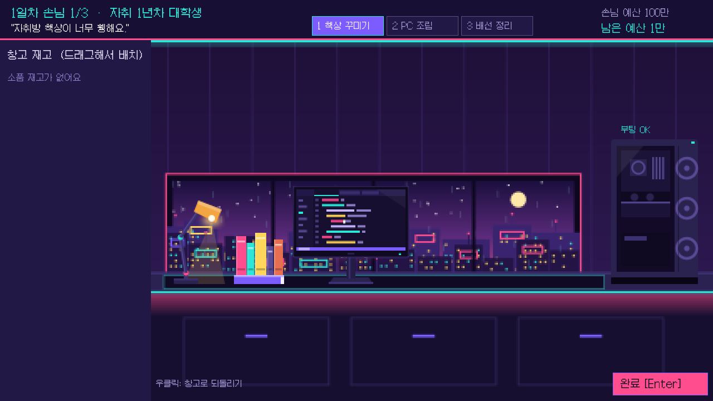
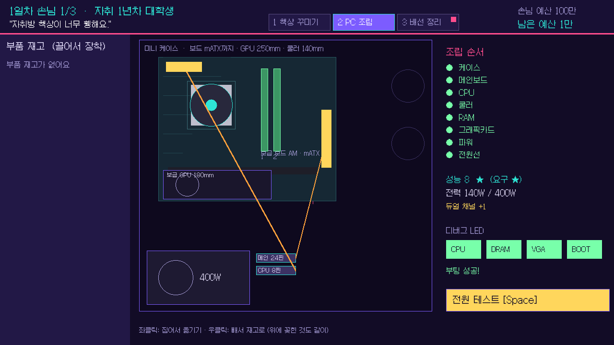
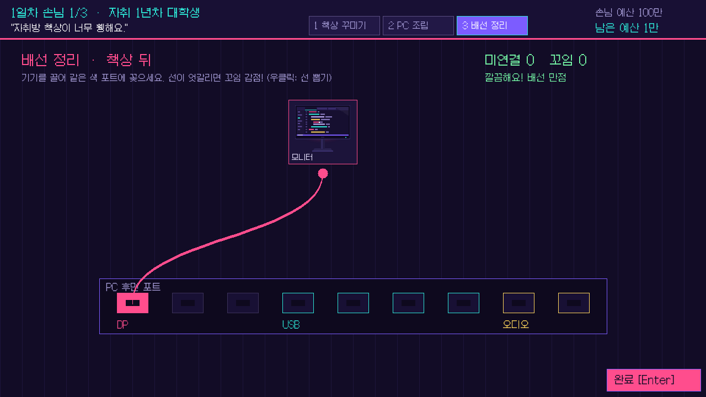

# 데스크테리어 의뢰소

손님의 **애매한 주문**을 읽고 책상을 꾸미고 PC를 조립해 주는 가게 운영 게임 ('좋은 피자, 위대한 피자' 방식)
2D 게임 프로그래밍 (이대현 교수) 학기 프로젝트 · Python + pico2d · 한준상

📎 **발표 자료**: [1차 발표 PPT](docs/데스크테리어의뢰소_발표.pptx) · [기획서 PPT](docs/데스크테리어의뢰소_기획서.pptx)





## 게임 루프 (하루 영업)

아침 시장(재고 · 업그레이드 구매) → 손님 3명: 애매한 주문 듣기 → 책상 배치 · PC 조립 · 배선 → 납품 · 채점 → 영업 마감 정산 → 다음 날

- **애매한 주문**: 손님은 "밤에 눈이 시리면 안 돼요"처럼 말만 하고, 원하는 분위기 · 필수 소품 · 성능은 숨겨져 있음. 납품 후 공개
- **재고**: 아침에 도매가(소매가의 60%)로 사 둔 것만 쓸 수 있음. 오늘 손님을 모른 채 사야 함
- **돈**: 손님은 자기 예산을 정가로 내고 별 1개당 예산의 5%를 팁으로 줌 (별 0개면 절반). 싸게 맞출수록 남음
- **PC 조립 (드래그 앤 드롭)**: 케이스 옆판을 연 화면에서 케이스 → 메인보드 → CPU → 쿨러 → RAM → 그래픽카드 → 파워 → 전원선 순서로 끌어다 꽂기. 소켓(AM/LGA) · 보드 크기(mATX/ATX) · 그래픽카드 길이 · 쿨러 높이가 맞지 않으면 안 들어가고, 끌고 있는 동안 자리가 하늘색(가능) / 분홍(불가 + 이유)으로 표시됨. 전원 테스트는 디버그 LED(CPU → DRAM → VGA → BOOT)로 막힌 곳을 알려 줌. 같은 RAM 2개를 맞는 슬롯에 꽂으면 듀얼 채널 +1, 쿨러가 약하면 성능 −3
- **업그레이드**: 게이밍 라인 · 하이엔드 부품 거래처를 사야 해당 상품을 들여올 수 있음

## 핵심 재미

- **조합 시너지**: 스탠드 옆에 책을 두면 '독서 콤보'처럼, 위치와 조합에 따라 점수가 오름
- **PC 조립 퍼즐**: 그래픽카드에 돈을 쓰면 꾸밀 돈이 모자라고, 파워 용량이 부족하면 부팅 실패
- **케이블 연결**: 모니터는 DP, 키보드 · 마이크 · 웹캠은 USB, 스피커 · 헤드셋은 오디오 포트에. GPU 등급이 DP 포트 수를 정하고(듀얼 모니터 = 중급 GPU 이상), 선이 꼬이면 감점
- **손님 리액션**: 가장 많이 깎인 항목을 손님이 말로 알려 줌

## 채점 (100점)

테마 일치 25 · 필수/금지 20 · PC 성능 20 · 조합 시너지 15 · 배선 10 · 예산 절약 10
60점 ★ / 75점 ★★ / 90점 ★★★

## 실행

```bash
pip install pico2d
python main.py
```

조작: 좌클릭 드래그(배치 · 조립 · 배선) · 우클릭(되돌리기 · 부품 빼기 · 선 뽑기) · 1 · 2 · 3 또는 상단 탭(책상 꾸미기 · PC 조립 · 배선 정리) · Space(전원 테스트) · Enter(납품) · ESC(일시정지: 손님 주문 다시 보기)

## 구조

| 파일 | 역할 |
|---|---|
| `main.py`, `game_framework.py` | 실행, 모드 스택(change · push · pop), 이벤트 분배(종료 · ESC · 마우스 좌표), 오버레이 그리기, 프레임 시간 (`python game_framework.py`로 자체 테스트) |
| `pause_mode.py` | ESC 일시정지 메뉴 (아래 화면 위에 겹쳐 그림) |
| `ui.py` | 상단 바 · 버튼 · 작업 탭 |
| `title_mode.py` → `market_mode.py` → `request_mode.py` → `decorate_mode.py` ⇄ `build_mode.py` · `wire_mode.py` → `result_mode.py` → `day_end_mode.py` | 화면(모드) |
| `room.py` | 벽 · 책상 위 2레이어 슬롯 배치 |
| `pcbuild.py` | PC 조립 규칙: 호환성 검사 · 장착 순서 · 전원선 · 디버그 LED(POST) · 성능 (`python pcbuild.py`로 자체 테스트) |
| `cables.py` | 포트 · 케이블 연결 · 꼬임(교차) 판정 (`python cables.py`로 자체 테스트) |
| `scorer.py` | 채점 · 시너지 · 부팅 판정 (`python scorer.py`로 자체 테스트) |
| `state.py` | 가게(돈 · 날짜 · 재고 · 업그레이드)와 주문(배치 · PC · 케이블) 상태, 정산 (`python state.py`로 자체 테스트) |
| `data/*.json` | 소품 · 부품 · 손님 주문(날짜별) · 업그레이드 데이터 (코드 수정 없이 추가) |
| `resource/`, `tools/make_sprites.js` | 소품 · 방 · PC 스프라이트와 생성 스크립트 |
| `docs/` | 1차 발표 PPT, 기획서 PPT, 화면 캡처 |

## 진행 현황

- [x] 1차: 기획 · 핵심 루프 프로토타입 (픽셀 사이버펑크 그래픽, 의뢰 3개)
- [ ] 손님 캐릭터 그래픽 (AI 이미지 생성 툴로 직접 제작)
- [x] 하루 영업 구조 프로토타입: 아침 시장 · 애매한 주문 · 정산 (3일, 손님 9명)
- [ ] 손님 표정 · 단골 · 소품 24개
- [ ] 자유 모드 · 저장 · 사운드

폰트: [갈무리(Galmuri)](https://github.com/quiple/galmuri), SIL OFL 1.1 (`resource/FONT_LICENSE.md`)
