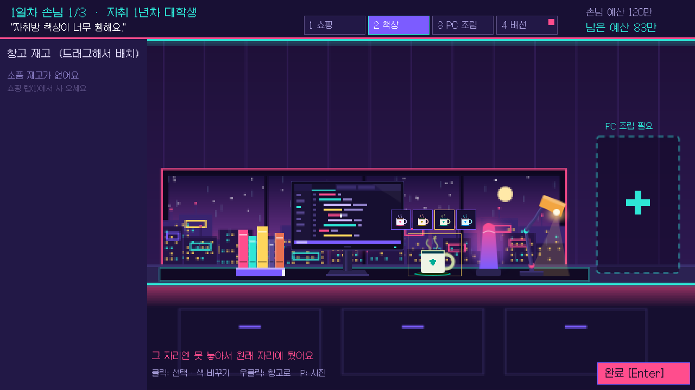
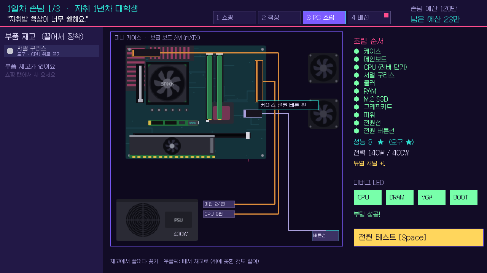
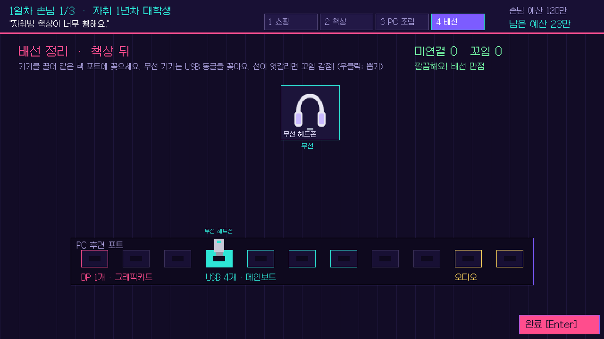
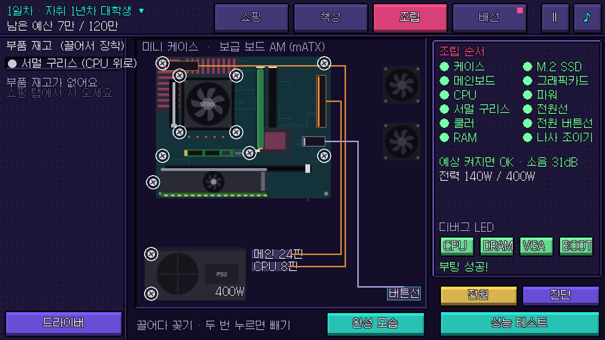

# 데스크테리어 의뢰소

손님의 **애매한 주문**을 읽고 책상을 꾸미고 PC를 조립해 주는 가게 운영 게임 ('좋은 피자, 위대한 피자' 방식)
2D 게임 프로그래밍 (이대현 교수) 학기 프로젝트 · Python + pico2d · 한준상

📎 **발표 자료**: [1차 발표 PPT](docs/데스크테리어의뢰소_발표.pptx) · [기획서 PPT](docs/데스크테리어의뢰소_기획서.pptx)





## 게임 루프 (하루 영업)

하루 뉴스(날씨 · 힌트) → 손님 등장(애매한 주문) → **1 쇼핑**(데스크몰에서 골라 결제) → **2 책상** 꾸미기 → **3 PC 조립** → **4 배선** → 납품 · 채점 → (손님 3명) → 영업 마감(마진 정산 · 가게 레벨 · 업그레이드) → 다음 날

- **애매한 주문**: 손님은 "밤에 눈이 시리면 안 돼요"처럼 말만 하고, 원하는 분위기 · 필수 소품 · 성능은 숨겨져 있음. 납품 후 공개
- **손님**: 12명의 네온 도트 초상화(기쁨 · 보통 · 실망). 4~5일차에는 단골이 다시 와서 지난번 별점에 따라 표정과 첫마디가 달라짐
- **책상 꾸미기**: 칸 없이 자유 배치(같은 레이어끼리만 안 겹치면 됨). 소품을 클릭하면 선택되고, 조명 · 머그 · 키보드 등 12종은 색 4가지 중 선택(같은 색 3개 = '톤 온 톤' 시너지). 날마다 창밖 날씨가 바뀜(비 · 노을 · 밤 · 눈 · 맑음)
- **부팅 화면**: 전원 테스트에 성공하면 바이오스 글자 → 바탕화면이 켜짐
- **사진 앨범**: 납품할 때 책상 사진이 자동 저장되고 P로 직접 촬영. 타이틀 → 앨범에서 모아 보기
- **소리**: 직접 합성한 효과음 15종 + 배경음 1곡 (M = 음소거)
- **쇼핑 (데스크몰)**: 소품 57종 · PC 부품 37종. 카테고리 → 상품 카드 → 상세 페이지(사양 · 설명 · 수량) → 장바구니 → 결제 → 영수증 → 창고로 배송. 남은 물건은 창고에 남아 다음 주문에 씀 (반품은 반값)
- **마진**: 손님은 자기 예산을 그대로 내고(별 1개당 팁 추가, 별 0개면 0원), 물건 값은 가게가 냄. 조건만 맞추면 싸게 할수록 전부 마진. 예산을 넘는 구성은 손님이 거절
- **성장**: 받은 별이 쌓이면 가게 레벨업 → 팁 비율 상승 · 게이밍 라인(Lv2) · 하이엔드 부품(Lv3) 업그레이드 구매 가능
- **PC 조립 (드래그 앤 드롭, 실제 순서)**: 케이스 → 메인보드 → 소켓 레버 열기 → CPU → 레버 닫기 → 서멀 구리스 → 쿨러 → RAM → M.2 SSD → 그래픽카드 → 파워 → 전원선(24핀 · CPU 8핀 · GPU 8핀) → 케이스 전원 버튼선. 소켓(AM/LGA) · 보드 크기 · 그래픽카드 길이 · 쿨러 높이가 안 맞으면 안 들어감. 전원 테스트는 디버그 LED(CPU → DRAM → VGA → BOOT)로 막힌 곳을 알려 줌
- **배선**: 모니터는 DP(그래픽카드가 개수 결정), USB 기기는 USB(메인보드가 개수 결정), 스피커 · 헤드셋은 오디오. 무선 기기는 USB 동글을 꽂음(선 없음). 선이 꼬이면 감점

## 저장

화면이 바뀔 때마다 · 게임을 끌 때 자동 저장. 타이틀에서 '이어하기'로 그 화면부터 계속 (조립 중인 PC · 책상 · 배선 · 장바구니까지).
저장 위치: `사용자 폴더/.desk-tir/save.json` · 마지막 날을 끝내면 기록 삭제

## 채점 (손님 만족도 100점)

테마 일치 25 · 필수/금지 25 · PC 성능 20 · 조합 시너지 15 · 배선 15  (예산은 점수가 아니라 마진)
60점 ★ / 75점 ★★ / 90점 ★★★

## 실행

```bash
pip install pico2d
python main.py
```

조작: 좌클릭 드래그(배치 · 조립 · 배선) · 클릭(소품 선택 · 색 바꾸기) · 우클릭(빼기 · 바로 담기) · 1~4 또는 상단 탭 · Space(전원 테스트) · P(사진) · M(음소거) · Enter(결제 · 납품) · ESC(일시정지)

## Godot 버전 (출시용 · 안드로이드 먼저)

같은 저장소에 Godot 4 프로젝트가 같이 들어 있고, `data/` · `resource/`를 pico2d 버전과 함께 씀 (데이터 · 그림을 고치면 양쪽에 반영).

1. [Godot 4.7](https://godotengine.org/download) 설치 → **가져오기**로 이 폴더의 `project.godot` 열기 → F5
2. 조작: 누르기 · 끌기(터치 = 마우스), **두 번 누르기 = 우클릭(빼기 · 바로 담기)**

| 파일 | 역할 |
|---|---|
| `godot/main.gd`, `godot/mode.gd` | 화면 스택 · 입력 분배 · 자동 저장, 화면 공통 그리기 도우미(pico2d와 같은 좌표) |
| `godot/screens.gd` | 타이틀 · 뉴스 · 손님 · 결과 · 영업 마감 · 상품 상세 · 영수증 |
| `godot/shop.gd`, `desk.gd`, `build.gd`, `wire.gd` | 쇼핑 · 책상 · PC 조립 · 배선 |
| `godot/db.gd`, `game.gd`, `pcbuild.gd`, `rules.gd` | 데이터, 가게 · 주문 상태와 저장, 조립 규칙, 배치 · 배선 · 채점 |
| `godot/tests.gd`, `godot/smoke.gd` | 규칙 테스트, 전체 플레이 자동 테스트 |

```bash
godot --headless --path . --script godot/tests.gd   # 규칙
godot --headless --path . --script godot/smoke.gd   # 손님 한 명 처음부터 납품까지
```

아직 Godot에 없는 것: 소리 · 부팅 연출 · 사진 앨범 · 일시정지 메뉴, 폰 화면에 맞춘 큰 글씨 · 버튼, 안드로이드 내보내기 설정



## 구조

| 파일 | 역할 |
|---|---|
| `main.py`, `game_framework.py` | 실행, 모드 스택(change · push · pop), 이벤트 분배(종료 · ESC · 마우스 좌표), 오버레이 그리기, 프레임 시간 (`python game_framework.py`로 자체 테스트) |
| `pause_mode.py` | ESC 일시정지 메뉴 (아래 화면 위에 겹쳐 그림) |
| `save_game.py` | 자동 저장 · 이어하기 (`python save_game.py`로 자체 테스트) |
| `ui.py` | 상단 바 · 버튼 · 작업 탭 |
| `title_mode.py` → `news_mode.py` → `request_mode.py` → `shop_mode.py` ⇄ `decorate_mode.py` ⇄ `build_mode.py` ⇄ `wire_mode.py` → `result_mode.py` → `day_end_mode.py` | 화면(모드) |
| `product_mode.py`, `receipt_mode.py`, `pause_mode.py`, `boot_mode.py`, `album_mode.py` | 겹쳐 뜨는 화면: 상품 상세 · 영수증 · 일시정지 · 부팅 연출 · 앨범 |
| `sound.py`, `photos.py` | 효과음 · 배경음(없어도 게임은 돌아감), 책상 사진 저장 |
| `tools/smoke_test.py` | 전체 플레이 자동 테스트 (`python tools/smoke_test.py`) |
| `tools/make_sounds.py`, `tools/extra_sprites.js` | 소리 합성, 초상화 · 날씨 배경 그림 생성 |
| `room.py` | 벽 · 책상 위 2레이어 슬롯 배치 |
| `pcbuild.py` | PC 조립 규칙: 호환성 검사 · 장착 순서 · 전원선 · 디버그 LED(POST) · 성능 (`python pcbuild.py`로 자체 테스트) |
| `cables.py` | 포트 · 케이블 연결 · 꼬임(교차) 판정 (`python cables.py`로 자체 테스트) |
| `scorer.py` | 채점 · 시너지 · 부팅 판정 (`python scorer.py`로 자체 테스트) |
| `state.py` | 가게(돈 · 날짜 · 재고 · 업그레이드)와 주문(배치 · PC · 케이블) 상태, 정산 (`python state.py`로 자체 테스트) |
| `data/*.json` | 소품 · 부품 · 손님 주문(날짜별) · 업그레이드 데이터 (코드 수정 없이 추가) |
| `resource/`, `tools/make_sprites.js`, `tools/more_sprites.js`, `tools/inbuild_sprites.js` | 소품 · 방 · PC 스프라이트와 생성 스크립트 |
| `docs/` | 1차 발표 PPT, 기획서 PPT, 화면 캡처 |

## 진행 현황

- [x] 1차: 기획 · 핵심 루프 프로토타입 (픽셀 사이버펑크 그래픽, 의뢰 3개)
- [ ] 손님 캐릭터 그래픽 (AI 이미지 생성 툴로 직접 제작)
- [x] 하루 영업 구조: 애매한 주문 → 쇼핑 → 작업 → 정산 (5일, 손님 15명), 가게 레벨 · 업그레이드
- [x] Godot 이전 1단계: 규칙 · 전체 화면 이식 (pico2d 버전은 학기 과제용으로 계속 유지)
- [ ] Godot: 소리 · 연출 · 폰 화면 UI · 안드로이드 내보내기
- [ ] 손님 표정 · 단골 · 소품 24개
- [ ] 자유 모드 · 저장 · 사운드

폰트: [갈무리(Galmuri)](https://github.com/quiple/galmuri), SIL OFL 1.1 (`resource/FONT_LICENSE.md`)
